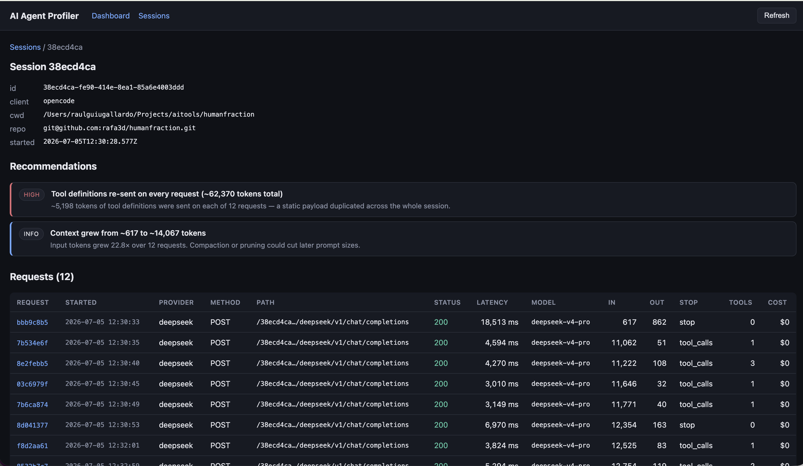
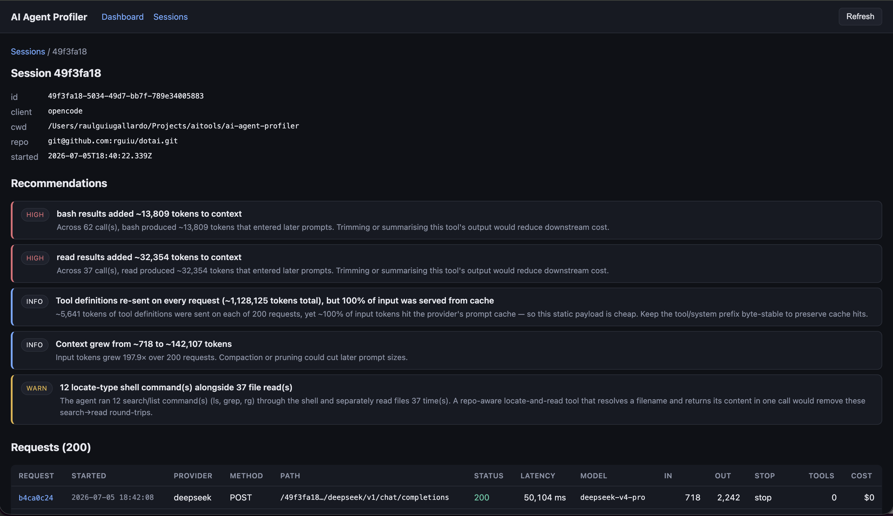

# AI Agent Profiler

A **local-first profiler for AI coding agents** — read-only by default, with an
optional shell-level filter layer that reduces tool output before it enters context
(via PATH hooks — see [hooks](./src/hook/)).

It sits as a transparent proxy between a coding agent (Claude Code, opencode) and an
LLM provider (Anthropic, OpenAI-compatible) and records high-fidelity traces of every
interaction — so you can measure how the agent uses tools, files, context, and models.

It is a **performance profiler for autonomous coding agents** — not an observability
dashboard, not an enterprise proxy. See [`VISION.md`](VISION.md).

On top of profiling, there are **shell hooks** that filter tool output before it
enters context — `git status`, `grep`, `ls`, `find`, `node --test`, `npm test`.
Unlike request rewriting (which destroys the provider's prompt cache), hooks never
touch the API request body. Enable per session with `aap run --hooks`.
See `aap hook help` for details.

**Live demo:** explore real captured sessions in a static, read-only clone of the
dashboard — no install required: **https://rguiu.github.io/ai-agent-profiler/**
(sample data from two DeepSeek/opencode benchmark sessions; paths and credentials redacted).

## How it works

Point your agent's provider base URL at the profiler and use it normally — no wrapper,
no special command:

```
aap serve            # terminal 1: proxy + read API
aap route --write    # once: routes claude/opencode/pi config files, and ollama's launcher
claude               # terminal 2: just use the agent
```

The profiler streams traffic through untouched, tees a copy to append-only trace files,
and indexes metadata in SQLite. Metrics are computed off the hot path so token streaming
stays unbuffered. See [`ARCHITECTURE.md`](ARCHITECTURE.md).

Sessions are attributed from the request itself: Claude Code advertises its own session
id (`x-claude-code-session-id`), which the proxy records, and the working directory is
recovered off the hot path from the `<env>` block in the system prompt. `aap route` is
only a config writer — it edits `~/.claude/settings.json`, `~/.config/opencode/opencode.json`
and `~/.pi/agent/models.json`, the files those agents already read, and `aap route --undo`
restores them. opencode's patch also carries the built-in `ollama-cloud` provider: it
resolves a model id to a provider that must exist in its own config, so without that
entry `ollama-cloud/<model>` — a model opencode knows from its catalog — is sent
straight to ollama.com and the run is real but untraced. Clients that advertise no
session id (opencode, pi, the Ollama CLI) are
grouped per client and split after `[sessions].idleTimeoutMs` of silence.

`ollama launch <agent>` is the exception: it ignores those config files, because at
launch time it hands the agent an inline config whose base URL is `OLLAMA_HOST + "/v1"`
(which also overrides the opencode/pi entries `aap route` writes). Routing it means
setting the environment for the `ollama` process, so `aap route --write ollama` adds a
marked block to `~/.zshrc` (or `~/.bashrc`) that defines a small `ollama` function:
`launch` runs with `OLLAMA_HOST` pointed at the proxy, everything else — notably
`ollama serve`, which uses `OLLAMA_HOST` as its bind address — runs untouched.
Re-open the shell after writing, and `aap route --undo` removes only that block.

The optimisations `aap run` used to apply as child-process env survive routing: the
`env` block it writes also carries `ENABLE_TOOL_SEARCH` (deferred tool schemas —
first-party Anthropic only), `CLAUDE_CODE_AUTO_MODE_SERVER=0` (off first-party
Anthropic) and, with `aap route --write --cache-1h`, Claude Code's native one-hour
prompt-cache TTL. Values you already export are respected; the same gating lives in
`src/routing/claude-env.ts` for both paths.

`aap run <agent>` still exists for the cases a config file can't express — an explicit
session id in the base URL (benchmark pinning), `--meta` tags, the keep-alive ping, and
the proxy-side cache-TTL rewrite for non-Claude clients — and it wins over the inferred
attribution. `aap run ollama` remains the way to launch Claude Code on Ollama cloud,
which ollama's own launcher cannot route. None of this metadata is ever sent to the LLM.

## Features

- Transparent, byte-faithful HTTP(S) proxy — never modifies requests.
- Per-session raw trace capture (requests, responses, streaming, timing) with secret redaction.
- Token, latency, cost, and tool metrics derived from raw traces (`aap parse`).
- Read API + a dark-mode web dashboard at `/ui`.
- Insights: tool usage, repeated tool calls, context growth, tool-result **token
  amplification**, and **context composition** (system-prompt size, tool-definition
  tokens, duplicated totals).
- **Prompt-cache awareness** — captures provider cache-hit tokens so findings reflect real cost.
- **Message-stack breakdown** — per-request context split by role (system/user/assistant/tool).
- **Request-kind classification** — labels each call (user turn, file-search subagent, recap, compaction, title-gen…) and breaks out the cost of non-user, agent-initiated traffic. See [`docs/REQUEST-KINDS.md`](docs/REQUEST-KINDS.md).
- **Command-usage analysis** — which shell programs run through `bash`, how often, by category.
- **Recommendations** — actionable findings per session (repeated reads, redundant calls,
  high amplification, context duplication, inefficient search→read).
- **Export & compare** — session reports as Markdown/JSON; sessions side by side.
- **Persistent engineering memory** — a local full-text index (SQLite FTS5) over every
  prompt, response, tool call, file edit, shell command, and error the proxy has seen.
  Search it from the dashboard (`/ui` → Search), the CLI (`aap search`), REST
  (`/search`), or agent-facing MCP tools (`search_history`, `search_edits`,
  `search_errors`, `find_previous_fix`, `recall_session`). `aap import` also pulls
  agent-native transcripts (Claude Code `~/.claude/projects`, opencode's local DB)
  into the same index, covering sessions that never went through the proxy.
- **MCP server** (`aap mcp`) — tools exposing the profiler's data for agent self-introspection.
- **Benchmark framework** — reproducible fixtures with verifiable outcomes, statistical
  validation (bootstrap confidence intervals, Cohen's d, Benjamini-Hochberg correction),
  and version-controlled regression thresholds that gate CI.

See [`ROADMAP.md`](ROADMAP.md) for what's next.

## Dashboard





## Installation

Requires **Node 20+**.

### npm (recommended)

```bash
npm install -g ai-agent-profiler
aap install           # seeds ~/.aap/config.toml, creates ~/.aap/data/
```

`aap install` is safe to re-run — it never overwrites existing config. If the
bundled example config has new fields, they are appended with a comment so you
can review them.

### From source

```bash
git clone <repo-url> ai-agent-profiler && cd ai-agent-profiler
npm install
npm run build
npm link              # puts `aap` on your PATH (or: npm install -g .)
aap install           # seeds ~/.aap/config.toml
```

### Manual config

```bash
mkdir -p ~/.aap
cp config.example.toml ~/.aap/config.toml   # edit providers / pricing / storage.dir
```

`aap` resolves config in this order: `$AAP_CONFIG` → `~/.aap/config.toml` →
`./config.toml`.

> Tip: set `storage.dir` to an absolute path (e.g. `~/.aap/data`) so captured
> data lives in one place regardless of where you start `aap serve`.

## Usage

```
aap install           # first-run: seeds ~/.aap/config.toml (safe to re-run)
aap serve             # start the proxy + read API (prints a line per request)
aap run <agent>       # launch an agent through the profiler, e.g. aap run claude
                     #   tag a run: aap run --meta task=explain --meta iter=1 opencode
aap parse [--all]    # derive token/cost/tool metrics from captured traces
aap index [--all]    # build the full-text search index from captured traces
aap import           # import agent-native transcripts (Claude Code, opencode) into search
aap search <query>   # search past prompts/responses/tools/errors (--errors, --file, --kind)
aap sessions         # list captured sessions (aap sessions rm <id> to delete)
aap commands         # break shell commands down by token cost
aap tag <id> k=v     # tag a session with metadata (e.g. verify=pass)
aap export <id>      # export a session report (Markdown; add --json for JSON)
aap compare <ids>    # compare sessions side by side (add --json for JSON)
aap check --baseline <tag> --current <tag>  # check regression thresholds (exit 0/1)
aap hook install     # install shell hooks for tool output filtering
aap mcp              # start an MCP server (stdio) for agent self-introspection
aap config           # print the resolved configuration
```

Inspect captured data over HTTP (same port as the proxy):

```
GET /ui                        # web dashboard (also at /)
GET /stats                     # totals: sessions, requests, tokens, cost
GET /sessions                  # sessions with rolled-up metrics
GET /sessions/:id              # session detail with its requests + analysis
GET /requests/:id?events=1     # request detail + raw trace events
GET /requests/:id/messages     # per-message context breakdown (roles, sizes)
GET /tools                     # global tool-usage totals
GET /commands                  # shell-command breakdown (?session=<id> to scope)
GET /search?q=...              # full-text search over indexed traces (&kind=&file=&errors=1)
GET /search/status             # index health: requests indexed, chunks, failures
GET /health
```

Open **`http://localhost:8080/ui`** for the dashboard.

### opencode + DeepSeek

DeepSeek is OpenAI-compatible. Add it — plus a pricing table so cost can be
computed — to your `aap` config:

```toml
[providers.deepseek]
upstream = "https://api.deepseek.com"

# Per-million-token rates (check current prices). Cost is null without this.
[pricing."deepseek-chat"]
inputPerMTok = 0.435
outputPerMTok = 0.87
```

Then launch opencode through the wrapper — no `opencode.json` edits needed:

```
aap serve                       # terminal 1
aap run opencode                # terminal 2, from your project
```

`aap run opencode` injects an `OPENCODE_CONFIG_CONTENT` that routes each configured
provider through the proxy. opencode still supplies the API key itself; the proxy only
forwards it and redacts it from stored traces. If a provider's base path isn't `/v1`,
set `apiPath` on its `[providers.<name>]` entry.

**Token & cost capture.** OpenAI-compatible providers omit the `usage` block from
streaming responses unless the request opts in, which otherwise leaves token counts —
and therefore cost — unrecoverable. The proxy automatically injects
`stream_options.include_usage` on streaming chat-completions for OpenAI-format
providers (`openai`, `deepseek`), so usage is always recorded on **every** request.
Pricing lookup is tolerant of a `provider/` prefix and
case, so a reported model like `deepseek/deepseek-chat` still resolves to the
`deepseek-chat` table above. If usage is genuinely absent, tokens and cost stay `null`
(never faked as `$0`) so a broken capture is visible.

### Ollama (local proxy)

Ollama's CLI talks to a daemon over its native API. Point the profiler's Ollama
upstream at your **local Ollama daemon** on `127.0.0.1` — not `ollama.com` — so the
daemon handles model routing and (for cloud models) authentication:

```toml
[providers.ollama]
upstream = "http://127.0.0.1:11434"
```

Then start the daemon and launch through the wrapper (`aap run ollama-cli` wraps the native `ollama` CLI; `aap run ollama` is the Claude Code launcher below):

```
ollama serve                    # local daemon on 127.0.0.1:11434
aap serve                       # terminal 1
aap run ollama-cli              # terminal 2 — pins the active ollama session
```

`aap run ollama-cli` sets `OLLAMA_HOST` to the proxy and marks the session as the active
Ollama session, so `/api/...` traffic is attributed to it. This works for both local
models and cloud models (`*:cloud`) — the daemon relays cloud requests to `ollama.com`
and authenticates via `~/.ollama/id_ed25519`. Pointing the upstream directly at
`https://ollama.com` returns **401** (the CLI sends no cloud credentials to what it
treats as a local daemon). See [Ollama specifics](#ollama-specifics) below for
attribution and parsing caveats.

### Claude Code + Ollama cloud

`aap run ollama` launches Claude Code against Ollama cloud through the profiler, asking
for the model the way `ollama launch claude` does:

```
export OLLAMA_API_KEY=...       # e.g. in ~/.zshrc; never written to config or disk
aap serve                       # terminal 1
aap run ollama                  # terminal 2 — lists your models, then starts Claude Code
```

- No config edit is needed: `ollama-cloud` (`https://ollama.com`) is a built-in provider.
  Define `[providers.ollama-cloud]` yourself to override the upstream. Restart
  `aap serve` after upgrading so it picks the built-in provider up.
- Skip the prompt with `aap run ollama --model gpt-oss:120b`. Without a TTY (CI,
  benchmarks) `--model` is required. Extra args go to Claude Code:
  `aap run ollama --model gpt-oss:120b claude -p "hello"`.
- If `OLLAMA_API_KEY` is unset, you're asked for it (hidden input, this run only).
- All Claude model tiers (opus/sonnet/haiku) are pinned to the chosen model, and
  `ENABLE_TOOL_SEARCH` is not forced on (Anthropic-only).
- Sessions are tagged `provider=ollama-cloud` and `model=<name>`. Add a `[pricing.*]`
  table for the model if you want cost estimates; otherwise cost stays empty.
- `claude` goes straight to Ollama cloud; `pi` and `opencode` use the real launcher (below).

#### pi / opencode via `ollama launch`

There are two ways to route `ollama launch`. Without a wrapper, `aap route --write ollama`
adds the scoped `ollama` function to your shell profile (see [How it works](#how-it-works)):

```
aap route --write ollama   # once; then re-open the shell
ollama launch opencode     # traffic goes through the profiler
```

`aap run ollama pi` and `aap run ollama opencode` do the same for one launch, with
`OLLAMA_HOST` pointed at the profiler only in the child's environment — useful when you
don't want a profile edit, or want to pin the model from the command line:

```
aap run ollama pi                              # pick a model, then `ollama launch pi`
aap run ollama --model gpt-oss:120b opencode   # skip the prompt
aap run ollama pi -- -p "hello"                # args after the agent go after `--`
```

- Requires `[providers.ollama]` pointing at your local daemon (`ollama serve`); no
  `OLLAMA_API_KEY` is needed because the daemon authenticates cloud models itself.
- The model list comes from the daemon; a blank answer lets `ollama launch` ask.
- Sessions are tagged `provider=ollama`, `launcher=ollama-launch`.

### Providers & known issues

`aap` redirects each agent's provider base URL through the proxy. How that redirect
works — and its caveats — differ per provider:

| Provider      | Routing                                                                                                                                                                     | Known issues                                                                                                                                                                      |
| ------------- | --------------------------------------------------------------------------------------------------------------------------------------------------------------------------- | --------------------------------------------------------------------------------------------------------------------------------------------------------------------------------- |
| **Anthropic** | `ANTHROPIC_BASE_URL` → `/<session>/anthropic`                                                                                                                               | —                                                                                                                                                                                 |
| **OpenAI**    | `OPENAI_BASE_URL` → `/<session>/openai`                                                                                                                                     | —                                                                                                                                                                                 |
| **DeepSeek**  | opencode only, via `OPENCODE_CONFIG_CONTENT`                                                                                                                                | Not routed for non-opencode agents (no base-URL env). Base path is `/v1`; set `apiPath` if different.                                                                             |
| **Bedrock**   | Host-based `/model/...` (no session prefix); attributed to the active `meta.bedrock` session                                                                                | Requires SigV4 re-signing, so AWS creds / `AWS_PROFILE` must be available to `aap serve`. Concurrent Bedrock sessions can mis-attribute (routing is host-based, not per-session). |
| **Ollama**    | Host-based `/api/...` and `/v1/...` (no session prefix); attributed to the active `meta.ollama` session. `aap route --write ollama` scopes `OLLAMA_HOST` to `ollama launch` | See below.                                                                                                                                                                        |

#### Ollama specifics

- `OLLAMA_HOST` accepts only scheme+host+port (no path), so requests can't carry a
  `/<session>/` prefix. They're matched by the `/api/` (or `/v1/`) path and attributed to
  the session started by `aap run ollama-cli` — concurrent Ollama sessions can
  mis-attribute.
- `ollama launch <agent>` builds the agent's base URL from `OLLAMA_HOST` when it starts,
  overriding the provider entries `aap route` writes for opencode/pi. That is why
  `aap route --write ollama` writes a shell function instead of a config file, and why
  the block is scoped to `launch`: `ollama serve` reads `OLLAMA_HOST` to pick its bind
  address and must keep using its own.
- `aap route` writes the loopback form (`127.0.0.1`) even when `[server].host` is a
  wildcard (`0.0.0.0`), because a bind address is not something an agent can dial.
- The daemon streams newline-delimited JSON labelled `application/json` (not
  `x-ndjson`); `aap` detects and parses it. Token usage comes from
  `prompt_eval_count`/`eval_count`; Ollama reports no cache tokens.

### Self-introspection via MCP

`aap mcp` starts a stdio MCP server so an agent can query its own captured behaviour —
"which requests cost the most?", "which file did I read most often?". It also exposes
the search index as memory tools, so an agent can ask "have we solved anything similar
before?" instead of re-exploring the repository:

- `search_history("ZMQ port race")` — full-text over prompts, responses, tools, errors
- `search_edits(file="src/store.py")` — past edits touching a file
- `search_errors("NullPointerException")` — past failures
- `find_previous_fix(symbol="TCPStore")` / `recall_session(query=...)` — relevant past
  sessions, grouped with sample snippets (summaries + links, never raw transcripts)

Add it to `opencode.json`:

```json
{
  "mcp": {
    "aap": { "type": "local", "command": ["aap", "mcp"], "enabled": true }
  }
}
```

## Shell hooks (tool output filtering)

Path-based wrappers in `~/.aap/bin/` that filter tool output before it enters the
agent context. Never touches the API request body or the prompt cache. Hooks are
on/off per session — pass `--hooks` to `aap run` to activate.

```
aap hook install          # install 7 wrappers (git, ls, grep, node, find, cat, npm)
aap hook status           # show installed hooks
```

When hooks are active (`aap run --hooks` or `AAP_HOOK_MODE=true`), `~/.aap/bin`
is prepended to PATH. The wrappers filter output:

- **git** — `status` (short), `diff` (tail -80), `log` (oneline -15), `show` (stat)
- **node** — `--test` strips passing tests, keeps failure details + diagnostics
- **npm** — `test`/`run build`/`run lint`/`run typecheck` → errors only, tail -10 on failure
- **grep/rg** — tail -40 lines
- **ls, find, cat** — truncated output (head -40 / head -60)

## Cache maintenance

**1h cache TTL (via `--cache-1h`).** Claude Code always requests the 5-minute
cache. Costs 2× input on write vs 1.25× for 5m but survives 12× longer — wins when
idle gaps fall between 5 min and 1 hour. There are two ways to get it:

- `aap route --write --cache-1h claude` writes Claude Code's own `promptCacheTtl` and
  `subagentPromptCacheTtl` settings — no launcher, and the bytes are the client's.
- `aap run claude --cache-1h` sets `meta.cache_ttl=1h` and the proxy rewrites
  `cache_control` markers to 1h before forwarding (the only option for non-Claude
  clients, and for Claude Code versions without the settings key).

**Keep-alive.** `AAP_KEEP_ALIVE=1 aap run claude` replays the last request with
`max_tokens: 1` to prevent cache expiry during idle. Best with `--cache-1h` (pings
every 48 min vs every 4 min).

These are the only proxy-level optimizations. An earlier effort to rewrite request
bodies (stripping tools, summarising history, collapsing system prompts) was found
to be counterproductive on cached providers — any edit to the byte prefix forces an
expensive cache rebuild. The design is documented for reference:

- [`docs/optimization/FINDINGS.md`](docs/optimization/FINDINGS.md)
- [`docs/optimization/STRATEGIES.md`](docs/optimization/STRATEGIES.md)
- [`docs/agents/anthropic.md`](docs/agents/anthropic.md), [`docs/agents/deepseek.md`](docs/agents/deepseek.md)

## Benchmarks

`benchmarks/` contains a corpus of small, self-contained fixtures (each with a planted,
verifiable bug) and a runner that executes the same tasks through an agent, tagged for
profiling.

### What you can compare

| Scenario                 | Why                                                                         | How                                                                                                                                                                                    |
| ------------------------ | --------------------------------------------------------------------------- | -------------------------------------------------------------------------------------------------------------------------------------------------------------------------------------- |
| **Agent A vs Agent B**   | opencode vs Claude Code — which solves tasks faster/cheaper?                | `./benchmarks/run.sh opencode --fixture task-queue --tag opencode` then `./benchmarks/run.sh claude --fixture task-queue --tag claude`, then `aap compare --run opencode --run claude` |
| **Optimization on/off**  | Does stripping tools or enabling progressive loading improve cost?          | Run baseline + experiment with different `--tag` names, compare with `aap check --baseline baseline --current experiment`                                                              |
| **Model comparison**     | Haiku vs Sonnet — is the cheaper model good enough?                         | Same agent, different `ANTHROPIC_MODEL` env var per run, tagged separately                                                                                                             |
| **Release over release** | Did v2.0 regress from v1.0 on the same tasks?                               | Tag baseline sessions with `--tag v1.0`, re-run on new version with `--tag v2.0`, then `aap check --baseline v1.0 --current v2.0`                                                      |
| **CI regression gate**   | Block PRs that degrade agent cost or success rate beyond allowed thresholds | `aap check --baseline <tag> --current <tag>` exits 0/1 based on `benchmarks/regressions.toml` thresholds                                                                               |

```
aap serve
./benchmarks/run.sh opencode --fixture task-queue --tag baseline
aap sessions           # find the runs
aap compare --run baseline     # side-by-side comparison
```

### Statistical validation

Compare distributions (not single points) with bootstrap confidence intervals and
non-inferiority tests:

```
node benchmarks/validate.mjs --baseline baseline --optimized optimize
```

Reports cost savings with 95% CI, quality non-inferiority, Cohen's d effect sizes,
and Benjamini-Hochberg correction for multiple comparisons.

### Regression guards

Version-controlled thresholds in `benchmarks/regressions.toml` define acceptable bounds
per metric (cost +10%, success rate −5pp, etc.). Gate CI against regressions:

```
aap check --baseline <tag> --current <tag>       # exit 0/1
```

### Agent registry

Add agents to `benchmarks/agents.toml` — no code changes needed:

```toml
[my-agent]
binary = "my-agent"
invoke = "-p --auto"
env = { API_KEY = "sk-..." }
```

See [`benchmarks/README.md`](benchmarks/README.md) and
[`docs/validation-architecture.md`](docs/validation-architecture.md).

## Development

Requires Node 20+.

```
npm install
npm run dev -- <command>   # run the CLI via tsx, e.g. npm run dev -- sessions
npm test                   # vitest
npm run typecheck          # tsc --noEmit
npm run lint               # eslint
npm run format             # prettier --write
npm run build              # compile to dist/
```

The proxy uses Node's native `http`/`https` for byte-faithful streaming; the SQLite index
uses `better-sqlite3`. Source is under `src/` (proxy, capture, store, parse, recommend,
api, ui, cli); the web dashboard is plain HTML/CSS/JS in `web/`.

## Documentation

- [`VISION.md`](VISION.md) — why the project exists.
- [`ARCHITECTURE.md`](ARCHITECTURE.md) — how it is designed and why.
- [`ROADMAP.md`](ROADMAP.md) — what is done and what comes next.
- [`docs/REQUEST-KINDS.md`](docs/REQUEST-KINDS.md) — how requests are classified (user turn vs subagent/recap/compaction/title) and the detection signals.
- [`docs/optimization/FINDINGS.md`](docs/optimization/FINDINGS.md) — what we tried to optimize, why it doesn't beat the cache, and where gains might still exist.
- [`docs/optimization/STRATEGIES.md`](docs/optimization/STRATEGIES.md) — per-strategy catalogue and cache-safety table.
- [`docs/validation-architecture.md`](docs/validation-architecture.md) — full validation & benchmark architecture: fixtures, statistical tests, regression guards, agent adapters, anomaly tracing, budgets, HITL scoring.
- [`docs/CACHE-BENCHMARK-METHODOLOGY.md`](docs/CACHE-BENCHMARK-METHODOLOGY.md) — how the byte-prefix cache works, TTL, cross-session warming, fair benchmark methodology.
- [`docs/agents/anthropic.md`](docs/agents/anthropic.md), [`docs/agents/deepseek.md`](docs/agents/deepseek.md) — per-provider caching and optimizer notes.
- [`docs/optimization/TODO.md`](docs/optimization/TODO.md) — future optimization roadmap (normalizePrefix, keep-alive, IASH; and why optimizeOnCold was abandoned).
- [`benchmarks/README.md`](benchmarks/README.md) — the benchmark corpus and runner.

## License

[MIT](LICENSE) © Raul Guiu
